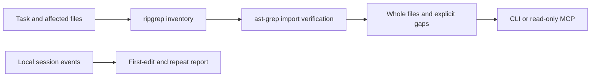

<h1 align="center">Editlane</h1>

<p align="center">Focused context for coding agents, with exact source and visible checks.</p>

<p align="center">
  <a href="LICENSE"></a>
  <a href="package.json"></a>
  <a href="#project-status"></a>
</p>

<p align="center">
  <a href="#quick-start">Quick start</a> ·
  <a href="#how-it-works">How it works</a> ·
  <a href="#connect-your-agent">Connect your agent</a> ·
  <a href="CONTRIBUTING.md">Contribute</a>
</p>

A small fix can turn into dozens of searches before a coding agent makes its first edit. Editlane gathers the affected files and nearby contracts in one request, then helps you measure where the investigation spends time.

It runs locally through a CLI or a read-only MCP server. You keep your existing agent and model; Editlane needs no API key.

## Project status

**v0.1 is a working prototype for JavaScript and TypeScript.** The CLI and MCP server are implemented, and the server is tested with the official MCP stdio client. Read-only MCP requests have run successfully in Cursor, Claude Code, and Codex. Native editing benchmarks remain experimental. Model speed, billed token savings, and stronger code quality have not been established.

## Quick start

You need **Node.js 22+** and [ripgrep](https://github.com/BurntSushi/ripgrep) on your `PATH`. macOS and Linux are the initial targets. Install from source; the package has not been published to npm.

```sh
git clone https://github.com/appdever01/editlane.git
cd editlane
npm ci --ignore-scripts
npm run build
```

Try a context request against Editlane itself:

```sh
node dist/cli.js focus "inspect context discovery" --root . --file src/context.ts --budget 100000
```

This request returns the context module, its local dependencies and direct consumers, the matching test file, and the package configuration. The output starts with metadata, followed by whole source files. Discovered check scripts are marked `not_run`.

For your own project, point `--root` at its directory and `--file` at an affected file relative to that root. Repeat `--file` for more targets. Use `--json` for structured output. The [CLI reference](reference/cli.md) explains budgets, recording, and every command.

## What you get

| Capability | Behavior |
| --- | --- |
| Focused context | Affected files, direct local imports, verified direct consumers, and nearby tests. |
| Exact source | Whole files with paths, inclusion reasons, byte counts, and SHA-256 hashes. |
| Visible gaps | Omitted files, unresolved imports, and discovery limits are included in the response. |
| Repository guidance | Applicable instruction files are returned separately with their directory scope. |
| Read-only MCP | Two tools for gathering context and auditing a recorded session. |
| Session evidence | Time to first edit, unchanged repeated calls, observed bytes, and recorded check results. |

The agent still needs to understand the code, follow affected contracts, make the edit, and run the required checks. Editlane discovers check scripts; it does not choose or execute them automatically.

## How it works



Start with a known file when you can. Editlane finds its direct dependencies, checks candidate consumers against parsed imports, and looks for nearby tests and configuration. Without `--file`, it ranks filenames against the task and asks for a file when it cannot find a useful match.

The source budget controls how much neighboring code is included. Requested files must fit in full; other files that do not fit are listed as omissions. Applicable instructions sit outside that budget and are never silently truncated. The host decides instruction precedence.

The MCP process keeps an in-memory AST cache keyed by content hashes. Every request reads current content, so even a same-size edit invalidates cached imports. Editlane does not maintain a persistent source index.

## Connect your agent

The server exposes `editlane_focus` and `editlane_audit`. Start it with:

```sh
node dist/cli.js serve --root /absolute/path/to/project
```

Register that command as a local stdio MCP server in your client. For clients using a `mcpServers` JSON configuration:

```json
{
  "mcpServers": {
    "editlane": {
      "command": "node",
      "args": [
        "/absolute/path/to/editlane/dist/cli.js",
        "serve",
        "--root",
        "/absolute/path/to/project"
      ]
    }
  }
}
```

Replace both absolute paths. The server is pinned to one repository root; update that path when connecting another project. Use an absolute Node executable path if your desktop client cannot find `node`.

For **Cursor**, save the JSON above in your project's `.cursor/mcp.json`. The CLI can approve and inspect this specific server:

```sh
agent mcp enable editlane
agent mcp list-tools editlane
```

Use an explicit root path. The tested Cursor CLI did not expand `${workspaceFolder}` in server arguments. Its login is separate from the editor; run `agent login` if `agent status` says it is signed out.

For **Claude Code**, run this from your project's directory:

```sh
claude mcp add --transport stdio --scope local editlane -- node /absolute/path/to/editlane/dist/cli.js serve --root /absolute/path/to/project
claude mcp get editlane
```

For **Codex**, register the same local command:

```sh
codex mcp add editlane -- node /absolute/path/to/editlane/dist/cli.js serve --root /absolute/path/to/project
codex mcp get editlane
```

Start a new client session after registration or changing the project root, so it starts the server with the saved configuration. Keep your local client configuration private. These commands register the read-only server; Editlane does not change agent permissions, hooks or model settings.

Give your agent a request such as:

> Use Editlane to gather context for the affected file. Read the returned contracts and tests, follow omitted context when needed, make the smallest complete change, then run the repository's required checks and review the diff.

A tiny task whose code is already known may need no context tool.

## Measure the investigation

Try the included synthetic session:

```sh
node dist/cli.js audit --journal examples/session.jsonl
```

It reports a first edit at nine seconds, three investigation calls, and one repeated read with an unchanged fingerprint. The recorded successful check is part of the fixture, not a check performed by the audit command.

For real sessions, the CLI can record explicit events and run commands with unchanged output and exit codes. Native client tools are not intercepted. See [session recording](reference/cli.md#session-recording) for the JSONL format and examples.

## Benchmark

```sh
npm test
npm run bench
```

The benchmark creates 100 unrelated modules and a small tag flow, then compares a full repository snapshot with a known-file context request. It verifies the expected files and retained check scripts before printing its measurements.

One development run produced:

| Measurement | Result |
| --- | ---: |
| Full repository snapshot | 693,268 bytes |
| Complete focused packet | 3,505 bytes |
| Packet size reduction | 99.49% |
| Cold context request | 27.92 ms |
| Warm context request | 13.98 ms |
| Plain snapshot read | 15.69 ms |

These are synthetic context measurements. Bytes are not billed tokens, and the cold request took longer than reading the snapshot. Real agent benchmarks need repeated tasks, unchanged acceptance tests, and a comparison of time to a correct edit.

## Limits and privacy

v0.1 resolves relative imports, extension substitutions, directory indexes, and nearest JSONC `tsconfig`/`jsconfig` aliases. Inherited configs, workspace package exports, language-server references, recursive barrel expansion, and computed imports are incomplete. Reverse candidates are selected by affected filenames, so renamed aliases can escape discovery. Packets flag these limits; use them to decide where to investigate further.

Ignored files, common secret filenames, binary files, invalid UTF-8, symlinks, and paths outside the root are excluded. Applicable guidance is read separately. This is not a secret detector: ordinary source or guidance may still contain private information.

Keep packets and journals out of Git and shared logs. Context discovery makes no network requests, but your agent client can send the returned context to its model provider. Journals also record command arguments; keep credentials out of those arguments. See the [security policy](SECURITY.md).

## Contribute

Read [CONTRIBUTING.md](CONTRIBUTING.md) for setup, checks, and the contribution workflow. Improvements to module resolution, native trace importers, and realistic agent benchmarks are useful next steps. Changes should reduce unnecessary calls while preserving exact source, affected consumers, and failed checks.

Report reproducible bugs through [issues](https://github.com/appdever01/editlane/issues/new/choose), ask questions in [Discussions](https://github.com/appdever01/editlane/discussions), and follow the [code of conduct](CODE_OF_CONDUCT.md).

## Credits and license

Editlane's planner, provenance, audit, and command recorder are original code released under the [MIT license](LICENSE).

It uses [ast-grep](https://github.com/ast-grep/ast-grep), [ripgrep](https://github.com/BurntSushi/ripgrep), [JSONC Parser](https://github.com/microsoft/node-jsonc-parser), [Zod](https://github.com/colinhacks/zod), and the official [MCP TypeScript SDK](https://github.com/modelcontextprotocol/typescript-sdk). [RTK](https://github.com/rtk-ai/rtk) is an optional integration for bounded Git history metadata.

[Serena](https://github.com/oraios/serena), [Headroom](https://github.com/headroomlabs-ai/headroom), [Repomix](https://github.com/yamadashy/repomix), [LLMLingua](https://github.com/microsoft/LLMLingua), [Context7](https://github.com/upstash/context7), and [TOON](https://github.com/toon-format/toon) informed the research. Those projects retain their own authorship and licenses. The [third-party notice](NOTICE.md) lists what ships and how it is used.
