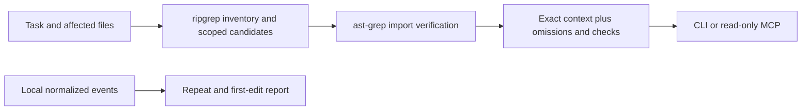

# Editlane

Get your coding agent to the right files in fewer calls, with exact source and visible checks.

An agent can spend minutes reading neighboring screens, repeating searches and loading tools before its first edit. Editlane prepares a focused context packet and helps you measure that investigation. It runs locally, works through a CLI or MCP, and needs no API key or model proxy.

**Status:** v0.1 prototype. JavaScript and TypeScript context discovery is implemented. MCP is tested with the official stdio client; separate live integration tests in Cursor, Claude and Codex are still needed. Native tools are not intercepted, and faster model sessions are not yet established.

## Try it

Requires Node.js 22+ and [ripgrep](https://github.com/BurntSushi/ripgrep). macOS and Linux are the initial targets.

```sh
git clone https://github.com/appdever01/editlane.git
cd editlane
npm ci --ignore-scripts
npm run build
node dist/cli.js focus "fix tag filtering" --root /path/to/project --file src/tags.ts
```

Start with a known file when possible. Without `--file`, Editlane ranks filenames against the task and asks for a file when it cannot find a useful match. It does not load the whole repository to guess.

The packet contains:

- Whole affected files, their direct local imports, verified direct consumers and nearby tests.
- File paths, roles, reasons, byte counts and SHA-256 hashes.
- Applicable repository guidance, including ignored instruction files, with their directory scope.
- Package check scripts marked `not_run`.
- Explicit omitted files, unresolved imports and discovery limits.

Use repeated `--file` arguments to expand the scope. `--budget` sets a source-byte budget, not a token budget. Requested files must fit in full; neighbors that do not fit are listed for retrieval. Instructions are included outside that budget. `--json` produces structured output; the default separates metadata from exact source.

## Connect an agent

Editlane exposes only two read-only MCP tools: `editlane_focus` and `editlane_audit`. Configure your client's local MCP server using the equivalent of:

```json
{
  "mcpServers": {
    "editlane": {
      "command": "node",
      "args": ["/absolute/path/to/editlane/dist/cli.js", "serve", "--root", "/absolute/path/to/project"]
    }
  }
}
```

Client configuration formats differ. The same command can be registered in Cursor, Claude Code or Codex; the server is pinned to one repository root. Editlane does not change your client settings or permissions. The host still decides which tools to call and which instructions take precedence.

A useful request is: “Use Editlane to gather the affected module, inspect the returned contracts and tests, then make the smallest complete change. Follow omitted context when needed, run the repository's required checks, and review the original diff.” A tiny task whose code is already known may need no context tool.

## See where a session spends time

```sh
node dist/cli.js audit --journal examples/session.jsonl
```

The example is synthetic. The report shows elapsed time from the first recorded event to the first edit, investigation calls, repeated calls with unchanged fingerprints, observed output bytes and recorded checks. A changed fingerprint invalidates reuse. Calls without a fingerprint are reported separately. Repeating a read can be justified; the report gives evidence rather than blocking it.

The input is normalized JSONL. Each event has an ISO `timestamp`, `kind` and `key`; optional fields are `fingerprint`, `durationMs`, `bytes`, `exitCode` and `signal`. Kinds are `start`, `read`, `search`, `context`, `edit`, `check` and `command`. Events must be in timestamp order. Search fingerprints must cover both the query and the searched content. Native client trace importers and automatic hooks are future work.

You can record explicit events and commands:

```sh
node dist/cli.js record --root /path/to/project --journal /private/path/session.jsonl --kind read --key src/tags.ts
node dist/cli.js run --root /path/to/project --journal /private/path/session.jsonl --kind check -- npm test
```

`record` hashes current file content for a read. `run` executes the exact argument list without a shell, streams stdout and stderr unchanged, preserves the child exit code and records the result. It does not choose or skip checks. New journals are private files, bounded to 10 MB. Command arguments are recorded; keep sensitive values out of them.

## Optional RTK integration

If [RTK](https://github.com/rtk-ai/rtk) is installed:

```sh
node dist/cli.js metadata --root /path/to/project --rtk
```

This delegates only a bounded recent-history listing to RTK. Exact source, checks and final diffs are left intact. RTK is loaded only when requested. No automatic shell rewriting or client hook installation is included.

## Architecture



The AST cache lives in the server process and keys entries by repository, path and content hash. Each request reads current content; a same-size edit still invalidates its parsed imports. No repository source is stored in a persistent index. Subprocesses use explicit argument arrays, read timeouts and bounded outputs.

v0.1 resolves relative imports, extension substitutions, directory indexes and nearest JSONC `tsconfig`/`jsconfig` aliases. It does not implement inherited configs, workspace package exports, language-server references, recursive barrel expansion or computed imports. Reverse candidates use affected filenames, then verify imports with the AST; renamed aliases can escape that candidate search. Packets flag these limits. Expand the investigation for contracts or consumers that need it.

Ignored files, common secret filenames, binary files, invalid UTF-8, symlinks and paths outside the root are excluded. Applicable instructions are read separately and are never silently truncated. This is not a secret detector: source and guidance may contain private information. Keep packets and journals out of Git and shared logs. Editlane does not send network requests during context discovery; connecting it to an agent can send the resulting tool response to that agent's provider.

## Reproduce the benchmark

```sh
npm test
npm run bench
```

The benchmark generates 100 unrelated modules and a small tag flow with an import, consumer, regression file, package scripts and guidance. It compares a full-repository snapshot with a known-file context request and verifies exact expected files and retained check scripts. It prints complete packet bytes, cold and warm timings, and cache hits.

One development run returned a 3,505-byte packet against a 693,268-byte snapshot: 99.49% fewer bytes. Gathering took 27.92 ms cold and 13.98 ms warm; the plain snapshot read took 15.69 ms. These are synthetic context measurements, not billed tokens or an AI speedup. The main hypothesis to test next is fewer model/tool rounds before a correct edit across realistic tasks, with unchanged acceptance tests and required checks.

## Build on it

The next milestones are native trace importers, broader module resolution, an optional language-server provider, and repeated live task benchmarks. Improvements should demonstrate fewer unnecessary calls without losing affected consumers, source fidelity or failed checks.

The test suite covers exact source, alias resolution, consumers, content-change invalidation, budgets, ignored files, symlinks, instruction scope, trace ordering, failure reporting and a real MCP client/server connection. Tests run with at most two workers. CI checks Node.js 22 and 24.

## Credits and license

Editlane's planner, provenance, audit and command recorder are original MIT-licensed code. It uses [ast-grep](https://github.com/ast-grep/ast-grep) for parsing, [ripgrep](https://github.com/BurntSushi/ripgrep) for discovery, [JSONC Parser](https://github.com/microsoft/node-jsonc-parser) for configuration, [Zod](https://github.com/colinhacks/zod) for schemas, and the official [MCP TypeScript SDK](https://github.com/modelcontextprotocol/typescript-sdk).

[RTK](https://github.com/rtk-ai/rtk), [Serena](https://github.com/oraios/serena), [Headroom](https://github.com/headroomlabs-ai/headroom), [Repomix](https://github.com/yamadashy/repomix), [LLMLingua](https://github.com/microsoft/LLMLingua), [Context7](https://github.com/upstash/context7) and [TOON](https://github.com/toon-format/toon) informed the research. They retain their own authorship and licenses; only the stated integrations ship. See [NOTICE.md](NOTICE.md).
